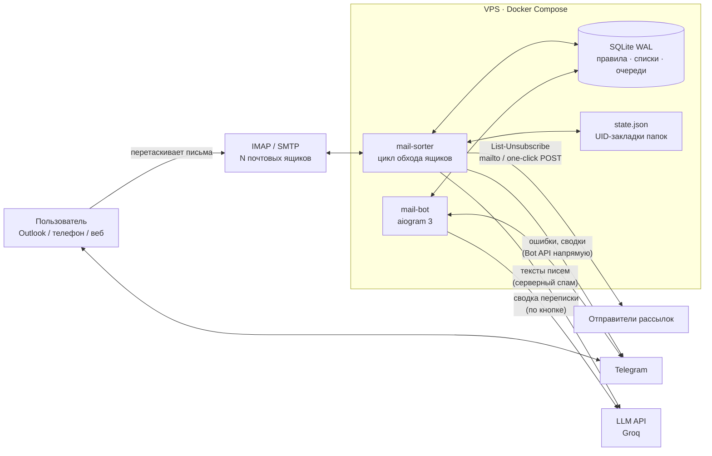

# mail-sorter

**Серверная сортировка корпоративной почты по IMAP: обучаемые правила, общий спам-фильтр для нескольких ящиков, автоматическая отписка от рассылок, Telegram-бот для управления и LLM-сводки переписки.**

Python 3.12 · IMAP / SMTP · SQLite (WAL) · aiogram 3 · LLM (OpenAI-совместимый API, Groq) · Docker Compose · pytest

---

## Задача

Компания перенесла почту нескольких доменов на shared-хостинг. Серверных фильтров (Sieve) там нет, фильтры веб-почты срабатывают только при открытом браузере, а правила Outlook — только пока Outlook запущен на конкретном компьютере. В итоге:

- письма от одних и тех же контрагентов и роботов приходится раскладывать руками в каждом ящике отдельно;
- спам и рассылки, заблокированные в одном клиенте, продолжают приходить на телефон и в другие ящики;
- от легальных рассылок надо отписываться вручную, ящик за ящиком.

## Решение

Сервис крутится 24/7 в Docker на VPS, сам ходит во все ящики по IMAP и раскладывает письма **прямо на сервере**, поэтому результат одинаков на всех устройствах и в любом клиенте.

Главная идея — **обучение жестом**: пользователь просто перетаскивает письмо в нужную папку (спам, «БАНК», «ДИСЛОКАЦИЯ»…) в любом клиенте и в любом ящике. Сервис замечает это, запоминает отправителя и дальше раскладывает его письма так же **во всех ящиках**, включая уже лежащие старые. Никаких настроек правил руками.

### Возможности

- **Правила в базе.** Правило = ящик (или все ящики), папка назначения, флаг «прочитано», условия: точный адрес, домен, подстрока темы, серверная метка спама. Правила перечитываются каждый цикл — изменения из бота применяются без перезапуска.
- **Обучаемые папки.** Перенёс письмо в папку правила с флагом `learn` — отправитель добавлен в правило для всех ящиков; его старые письма сразу ищутся и переносятся. «Последнее слово за пользователем»: переложил отправителя в другую обучаемую папку — из прежней он снимается.
- **Общий спам-фильтр** для всех ящиков с белым списком и защитой собственных доменов.
- **Отписка от рассылок** по заголовку `List-Unsubscribe` (RFC 2369 / RFC 8058) — только для писем, которые пользователь сам отправил в спам. После отписки адрес держится в фильтре, пока отправитель не замолчит на неделю, затем снимается — чтобы полезные транзакционные письма снова доходили.
- **Telegram-бот** (только для владельца): списки спам-адресов и доменов с оценкой «не попал ли сюда кто-то нужный», скрытие, блокировка домена целиком, история отписок, поиск адреса по всем правилам (адрес можно прислать прямо строкой из письма — «Компания <info@…>»), снятие адреса с правила с **возвратом его писем во входящие**, исключение одного адреса из домена, заблокированного целиком. При проверке адреса сразу видно, из каких ящиков мы ему писали, а через минуту-две приходит отчёт «где его письма»: сколько писем от него в каждом ящике и каждой папке, сколько мы отправили ему, даты первого и последнего письма — для аналитики переписки с контрагентом. Под отчётом кнопки: «🧠 Сводка нейронкой» (о чём переписка в каждом ящике и чего он хочет — по пяти последним его и нашим письмам с ящика, без цитат, подписей и вложений), «🚫 В спам» (как ручной перенос: все ящики + отписка; для тех, кому мы писали, — с подтверждением) и «✅ Не спам» (исключение + возврат из спама).
- **Серверный спам под контролем.** Хостинг сам помечает часть писем как спам и ошибается на живых контактах. Метка сервера не трогает тех, кому мы писали из любого ящика. Если письмо ушло в спам только из-за метки, приходит уведомление: отправитель, тема, общая сводка по его последним (до пяти) письмам из всех ящиков — о чём пишет и чего хочет (опционально — через LLM), переписка и письма от него по всем ящикам, и две кнопки — «оставить в спаме» (обучение и отписка по всем ящикам) или «не спам» (исключение и возврат писем во входящие).
- **Сводки в Telegram:** по каждому выученному адресу — сколько старых писем и в каких ящиках перенесено, чем кончилась отписка; ошибки ящиков с ограничением частоты и сообщением о восстановлении.

## Архитектура



Два контейнера на одном образе и общая база. Бот только читает и меняет записи в SQLite, а с почтой работает исключительно сортировщик: например, кнопка «вернуть письма во входящие» ставит задание в очередь, его выполняет сортировщик на ближайшем цикле и присылает сводку. Поэтому падение бота не останавливает сортировку, а уведомления об ошибках сортировщик шлёт напрямую в Bot API, минуя контейнер бота.

### Цикл обработки одного ящика

1. Перечитать правила из базы.
2. **Обучение:** новые письма в обучаемых папках → отправители в правила, отписка в очередь, открыть сводку.
3. **Возвраты:** задания «вернуть во входящие» из бота.
4. **Контакты:** новые адресаты из «Отправленных» по ящикам — защита от серверной метки, «полезность» адресов в боте.
5. **Сортировка:** заголовки только новых писем во всех папках → первое подходящее правило → перенос.
6. **Догоняющий поиск:** для адресов и доменов, появившихся в правилах после прошлого прохода, — `SEARCH FROM` по всем папкам и перенос старых писем.
7. **Запросы из бота:** письма отправителя по всем папкам — для уведомлений о серверном спаме и отчётов «где его письма».

После обхода всех ящиков: очередь отписок, перевод «замолчавших» отписанных адресов, отправка готовых сводок.

## Нейронка (LLM)

LLM здесь — помощник для принятия решения, а не фильтр: ни одно письмо не переносится по её мнению. Подключается через любой OpenAI-совместимый API (`LLM_API_KEY`, `LLM_API_URL`, `LLM_MODEL`); в эксплуатации — Groq, `openai/gpt-oss-120b`, бесплатный тариф. Без ключа всё работает, вместо сводки — начало текста письма.

Где используется:
- **Уведомление о серверном спаме** — автоматически: общая сводка по последним (до пяти) письмам отправителя из всех ящиков — кто пишет и чего хочет.
- **«🧠 Сводка нейронкой» под отчётом «где его письма»** — только по кнопке: по пять последних его и наших писем с каждого ящика. Ответ строго по форме: «Кто это / По ящикам: что присылал он, что писали мы, что он ответил, на чём остановились / Вывод: переписка, рассылка или спам».

Как устроено:
- **Подготовка текста:** `text/plain`, иначе HTML без тегов; вложения не читаются и не отправляются; вырезаются цитаты (`>`, «-----Original Message-----», «От: …», «… пишет:»), подписи и ссылки — в ответах иначе повторяется вся прошлая переписка.
- **Лимиты:** бесплатный тариф — 8000 токенов в минуту и 1000 запросов в сутки. Письма укладываются в бюджет символов: сначала каждое укорачивается (600 → 200 символов), потом выкидываются самые старые; в ответе указано, сколько не влезло.
- **Рассуждающая модель:** у `gpt-oss` скрытые «мысли» тратят тот же лимит, что и ответ, и ответ обрывался — передаётся `reasoning_effort=low`, обрыв по `finish_reason=length` помечается явно.
- **Направление писем:** модель путала, кто кого о чём просил, — каждое письмо помечено «ОН → НАМ» / «МЫ → ЕМУ».
- **Ошибки API** (лимит 429, размер 413, ключ 401, сеть) возвращаются в бот понятным текстом, кнопку можно нажать снова; Cloudflare перед API отсекает стандартный User-Agent Python — запросы идут со своим.
- **Приватность:** переписка уходит во внешний API только по явному нажатию; тексты для сводки хранятся в базе 3 дня и стираются, цифры отчёта остаются.

## Ключевые инженерные решения

| Проблема | Решение |
|---|---|
| Полный перебор всех писем каждую минуту — тысячи запросов | **Инкрементальный обход:** для каждой папки хранятся `UIDVALIDITY` и последний обработанный UID; без изменений папка пропускается по одному `STATUS`. Смена `UIDVALIDITY` → перечитать папку. Полный проход — при старте и раз в сутки ночью. |
| Сервис сам кладёт письма в папку спама и мог бы «учиться» на своих же переносах | После своих переносов закладка обучаемой папки сдвигается на текущий `UIDNEXT`. Учимся только на действиях пользователя. |
| Новое правило не трогает старые письма до ночного прохода | **Догоняющий поиск:** множество уже прочёсанных целей хранится в состоянии ящика; новые цели обрабатываются точечным `SEARCH FROM` сразу. Снятые с правила цели забываются, чтобы при возврате прочесать их снова. |
| `SEARCH FROM` — поиск по подстроке (`xuser@` совпадёт с `user@`) | Сервер только находит кандидатов, решение принимается по разобранному заголовку `From`. |
| Отписка ходит по ссылкам из чужих писем — риск SSRF и подтверждения спамерам «ящик живой» | Только из заголовка, только `mailto:` или `POST One-Click` по `https`; без редиректов, внутренние и приватные адреса запрещены; только для писем, которые пользователь сам отправил в спам; от настоящего спама (метки сервера, домены) отписка не запускается. |
| Подписка у каждого ящика своя | Отписка ставится в очередь по паре «отправитель + ящик». |
| Ложное срабатывание бьёт по бизнесу сильнее пропущенного спама | Собственные домены не учатся и спамом не считаются; бесплатные почтовики нельзя заблокировать доменом; ручное снятие адреса — исключение, которое сильнее доменного правила и серверной метки. |
| Два процесса пишут в одну базу | SQLite в режиме WAL с `busy_timeout`; миграции схемы при старте (`ALTER TABLE` по `PRAGMA table_info`). |
| Сводка «сколько писем перенесено во всех ящиках» требует данных из N независимых проходов | Отчёт открывается в момент обучения; каждый ящик дописывает свой результат; сообщение уходит, когда отметились все ящики и отписка завершена (или по таймауту — с перечнем непроверенных). |
| Спам-фильтр хостинга ошибается, а пользователь об этом не узнаёт | Метка сервера игнорируется для адресов из «Отправленных». Перенос только по метке открывает уведомление с выбором; все ящики сначала досчитывают письма и переписку с отправителем, затем приходит одно сообщение с кнопками. Решение превращается в обычные механизмы: обучение или исключение + возврат. |
| Сводка переписки нейронкой упирается в лимит токенов и путает направление писем | Бюджет символов с укорачиванием и отбрасыванием старых писем, `reasoning_effort=low`, явные метки «ОН → НАМ» / «МЫ → ЕМУ», жёсткая форма ответа; запрос только по кнопке. |
| Письма без указанной кодировки, HTML-только | Текст для уведомления: `text/plain` → иначе HTML без тегов; кодировка из заголовка → UTF-8 → Windows-1251; цитаты, подписи и ссылки вырезаются. |
| Кириллица в именах папок, неразрывные пробелы от Outlook | Modified UTF-7 (RFC 3501) реализован и покрыт тестами; имена сравниваются нормализованными. |

## Модель данных

```
rules     ящик | '*', имя, папка, mark_read, spam_header, learn, unsubscribe, position, enabled
entries   rule → addr | domain | subject, статус, источник (seed/learned/bot/manual), скрыт, даты
          статусы: active → unsubscribing → unsubscribed;  removed — снят вручную (исключение)
unsubs    очередь отписок: запись, ящик, заголовки, результат
reports   сводки по выученным адресам: прогресс по ящикам
restores  задания «вернуть во входящие» из бота: прогресс по ящикам
notices   письма, унесённые только по метке сервера: тема, суть, письма и переписка по ящикам, решение
contacts  кому мы писали (из «Отправленных») — для оценки «полезности» и защиты от серверной метки
contact_boxes  то же по ящикам: из какого ящика сколько писем
lookups   отчёты «где его письма» из бота: папки, отправленные, даты и тексты последних писем по ящикам
          (тексты — только для сводки по кнопке, стираются через 3 дня), решение спам / не спам
domains   скрытие доменов в боте
```

## Тестирование

**76 тестов (pytest)**, IMAP-сервер подменяется фейком в памяти, который поддерживает `LIST / STATUS / SELECT / UID SEARCH / FETCH / STORE / MOVE` и считает запросы. Это позволяет проверять не только результат, но и экономность: «без новых писем — ни одного `FETCH`», «по уже прочёсанному адресу повторно не ищем».

Покрыто:
- инкрементальный обход, смена `UIDVALIDITY`, перечитывание правил между проходами;
- обучение во всех обучаемых папках, защита от обучения на собственных переносах, «последнее слово за пользователем», приоритет правил ящика над общими;
- полный жизненный цикл отписки: очередь → отписка → неделя тишины → снятие с фильтра → повторный спам без повторной отписки;
- отписка: разбор заголовков, отказ от ссылок без one-click, запрет приватных адресов, частичный отказ одного из способов;
- сквозной сценарий на трёх ящиках: адрес выучен в одном, старые письма найдены в других, одна сводка, без дублей;
- «не помечать прочитанным» для обучаемых папок и при возврате во входящие;
- экраны и действия бота без Telegram (вынесены в отдельный модуль), лимит 64 байта на `callback_data`, извлечение адреса из скопированного текста;
- серверный спам: защита контактов, уведомление с подсчётом по ящикам, оба решения и их последствия во всех ящиках;
- извлечение текста письма: plain/HTML, отсутствующая или неверная кодировка, цитаты и подписи, общая сводка LLM по последним письмам отправителя (не больше пяти) с откатом на начало текста при ошибке;
- учёт отправленных по ящикам с разовой пересборкой истории без двойного счёта в общем учёте;
- отчёт «где его письма»: точное совпадение отправителя, папки, отправленные, даты, ожидание всех ящиков; кнопки «в спам» (обучение и отписка в каждом ящике, подтверждение для контактов) и «не спам» (возврат из спама);
- сводка переписки нейронкой: обрезка цитат Outlook / веб-почты, укладка в лимит токенов (сначала укорачиваем письма, потом выкидываем старые), понятная ошибка при лимите API, очистка текстов через 3 дня;
- миграция базы старой схемы.

```bash
pip install -r requirements.txt pytest
python -m pytest -q
```

## Развёртывание и эксплуатация

- Docker Compose: `mail-sorter` и `mail-bot` на одном образе, `restart: unless-stopped`, HEALTHCHECK по heartbeat-файлу у каждого контейнера, лимиты памяти, непривилегированный пользователь, ротация логов.
- Уведомления об ошибках с ограничением частоты и сообщением о восстановлении ящика.
- Секреты и персональные данные не попадают в git: пароли ящиков и токен — в `.env`, стартовые правила — в `rules.yaml`, база и состояние — в `data/`; всё в `.gitignore`. Перед каждым пушем — скан индекса на реальные домены, адреса и токены.
- Бот отвечает только одному Telegram ID; остальным молчит.
- Внешняя LLM (OpenAI-совместимый API, `LLM_API_KEY`) необязательна и получает только: тексты писем отправителей, которых сервер сам пометил как спам (до пяти последних), и переписку с адресом — только по явной кнопке «🧠 Сводка нейронкой». Вложения не отправляются никогда. Без ключа — начало текста.

### Структура

```
app/
  main.py         цикл обхода ящиков, очереди отписок, сводки, логирование
  sorter.py       IMAP: инкрементальный обход, обучение, догоняющий поиск, возвраты, перенос
  db.py           SQLite: правила, списки и статусы, очереди, отчёты, миграции, первичный перенос из YAML
  unsub.py        отписка по List-Unsubscribe (mailto / one-click POST)
  bot.py          Telegram-бот (aiogram 3)
  views.py        экраны и действия бота — без зависимости от Telegram
  scoring.py      оценка «полезности» адресов и доменов
  snippet.py      текст письма и краткое содержание для уведомлений (опционально — LLM)
  notifier.py     уведомления в Telegram с ограничением частоты
  state.py        закладки инкрементального обхода
  config.py       настройки из env, модель правила
  imap_utf7.py    modified UTF-7 для имён папок
  healthcheck.py  Docker HEALTHCHECK
tests/            pytest + фейковый IMAP-сервер
```

### Запуск

```bash
cp .env.example .env              # ящики и пароли (JSON), хосты, TG_BOT_TOKEN, TG_ADMIN_ID
cp rules.example.yaml rules.yaml  # стартовые правила — один раз переносятся в базу
chmod 600 .env rules.yaml
mkdir -p data && chown 10001 data # контейнеры работают не от root
docker compose up -d --build
```

Боту — `/start` с аккаунта `TG_ADMIN_ID`.

## Ограничения

- Без `MOVE` перенос делается через `COPY` + `\Deleted` + `EXPUNGE`; без `UIDPLUS` `EXPUNGE` удаляет из папки все письма с флагом `\Deleted` (как и большинство клиентов).
- Отписка возможна только при наличии `List-Unsubscribe`; часть отправителей её игнорирует, поэтому адрес остаётся в фильтре до недели тишины.
- Письма, возвращённые из спама во входящие, сохраняют флаг «прочитано», поставленный спам-правилом: отличить его от прочитанного пользователем невозможно.
